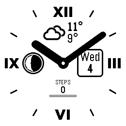
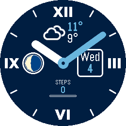
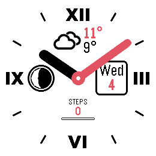
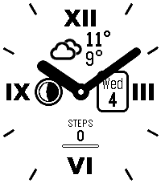
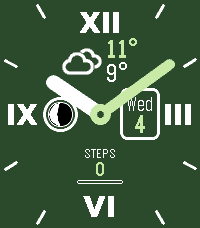
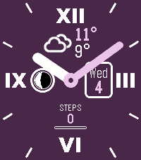

# Your Style Light

*A clean analog face with weather, moon phase and date.*

     

A Pebble watchface (v1.0.0) for Pebble Round 2 (gabbro) and Pebble Time 2 (emery).

Your Style Light is the easy-going sibling of [Your Style](https://github.com/ProggroP/YourStyle):
Roman numerals at XII, III, VI and IX, bold rounded hands and a small centre
hub. It looks right out of the box and needs no setup.

## What the dial shows

| Position | Content |
|---|---|
| Top | Weather symbol with today's high and low ([Open-Meteo](https://open-meteo.com), every 30 minutes, no account needed) |
| Left | Moon phase, computed on the watch |
| Right | Weekday and date, English or German |
| Bottom | Steps today, with a bar towards the daily goal |

## Settings

- **Template**: Classic (black on white, default), Noir, Swiss, Ivory, Blush,
  Navy, Ocean, Forest, Plum, Sport. A template sets all colours; changing a
  single colour afterwards switches to *Custom*.
- **Colours**: background, numerals and ticks, hour hand, minute hand, hub,
  text and weather symbol, highlights, moon lit and dark side.
- **Style**: minute track (off by default), solid, hollow or inlaid hands
  (solid by default), date frame, moon ring, step goal bar and goal.
- **Show**: weather, moon phase, date, steps and hour ticks.
- **Language**: English (`Mon`, `STEPS`) or German (`Mo`, `SCHRITTE`).
- **Weather**: current conditions or today's forecast as the symbol; Celsius,
  Fahrenheit or automatic by phone region.

## Weather symbols

The twelve symbols are rendered from
[Weather Icons](https://erikflowers.github.io/weather-icons/) by Erik Flowers
and Lukas Bischoff (SIL Open Font License 1.1, see
`LICENSES/WeatherIcons-OFL.txt`). `tools/make_icons.py` scales them,
makes the strokes a little bolder and reduces them to four opacity levels. The
watch recolours the sprite through its 2-bit palette, so the symbols follow
the theme colour with soft edges.

```bash
python tools/make_icons.py path/to/weathericons-regular-webfont.ttf
```

## Building

```bash
pebble build
pebble install --emulator gabbro
```

`tools/theme_shots.py` sends the colour templates to a running emulator and
takes one screenshot per template.

## License

MIT, see [LICENSE](LICENSE). The weather symbols are under the SIL OFL 1.1.
